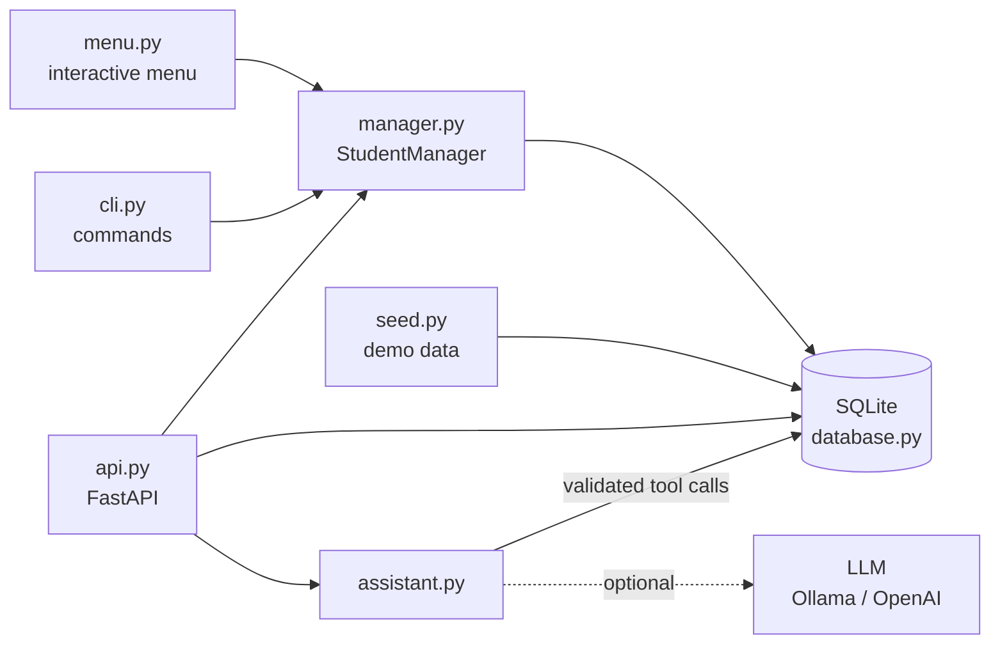

# Student Grade Manager

This started as an OOP exercise: a menu program for adding
students and working out their grades. I kept building on it, and it now
has SQLite storage, a command line, marks per subject and term, a REST API,
and an optional AI assistant you can ask questions in plain English.

**Built with:** Python, SQLite, FastAPI, Pydantic, pytest, Docker, and
optionally Ollama or any OpenAI-compatible model.

**Try it live:** [API docs](https://keval-grade-manager.onrender.com/docs), where you can run every endpoint
from the browser. It's on Render's free plan, so the first visit after a quiet spell can take up to a minute while it wakes up.

## What it does

- Add, find, update and remove students, with grades A-F and pass/fail
- Two kinds of student (Computer Science and Business) that share a base class
- One mark per subject per term (like Databases in 2026-S1)
- Class average for a subject, and who's below a given mark
- Made-up demo data, so I never need real student records to show it off
- Everything works from the menu, from commands, or over the API

The OOP parts I was practising: an abstract `Student` class with
`ComputerScienceStudent` and `BusinessStudent` inheriting from it,
methods like `display()` and `to_dict()` overridden per type, and
properties that validate the name, mark and age.

## How it fits together



The menu, the commands and the API all go through the same
`StudentManager` and the same database, so they always agree.

## Running it

The menu and commands only need Python (SQLite comes with it):

```bash
python main.py                    # interactive menu
python main.py list
python main.py find Aisha
python main.py add --type cs --name Aisha --mark 72 --age 20 --course-name "BSc CS" --course-code CS101 --language Python
python main.py update-mark Aisha 68.5
python main.py summary
python main.py --help
```

Subject results, using a separate demo database:

```bash
python main.py --db demo.db seed                 # 30 made-up students, 360 results
python main.py --db demo.db results "Aisha Doyle"
python main.py --db demo.db add-result "Aisha Doyle" Databases 2026-S1 74
python main.py --db demo.db subject-average Maths --term 2026-S1
python main.py --db demo.db below Databases 40
```

Terms look like `2026-S1` (year and semester), and subject names get tidied,
so `databases` and `Databases` count as the same subject. `seed` refuses to
touch a database that already has students in it, so it can't wipe real data.
The demo data is random but repeatable (`--random-seed`). Each made-up
student gets an "ability" level, so a strong student stays strong across
subjects instead of getting random marks everywhere.

### The API

With Docker, which starts with the demo data already loaded:

```bash
docker build -t grade-manager .
docker run -p 8000:8000 grade-manager
```

Or locally:

```bash
pip install -r requirements.txt
uvicorn api:app --reload
```

Then open http://127.0.0.1:8000/docs.

It's also live at https://keval-grade-manager.onrender.com/docs, deployed on
[Render](https://render.com) using `render.yaml` in the repo root, with the same 30 made-up students. The AI assistant is off
on the live version, so `/ask` returns 503 there.

| Endpoint | What you get |
|---|---|
| `GET /students` | Everyone's name, type, course, mark and grade (ages stay private) |
| `GET /students/{name}` | One student and their subject results |
| `GET /subjects` | Subjects that have results |
| `GET /subjects/{subject}/average?term=` | Class average, for one term or all |
| `GET /subjects/{subject}/below?mark=&term=` | Students under a mark |
| `POST /ask` | The AI assistant (below) |

Bad input like a term of `2026-S3` or a mark of 150 gets a 422.

## The AI assistant

Send `POST /ask` with something like
`{"question": "Who is below 40 in Databases in 2026-S1?"}`.

The model never sees the database and never writes SQL. It can only ask me
to run one of four read-only functions, and my code runs them:

| Tool | Returns |
|---|---|
| `list_subjects` | Subject names |
| `class_average(subject, term?)` | The average and how many marks it's based on |
| `students_below(subject, mark, term?)` | Names and marks under the threshold |
| `student_results(name)` | One student's subject marks |

One question goes round a loop like this:

```text
question -> model picks a tool -> arguments checked with Pydantic
         -> tool runs on SQLite -> result goes back to the model
         -> model answers -> every number checked against the tool results
```

Things I put in so it can't go wrong quietly:

- Only those four tools exist. If the model asks for something else (like
  `run_sql`) or passes a silly argument (a mark of 500), nothing runs and it
  gets told why.
- Every number in the final answer has to appear in a tool result or in the
  question. That stops it inventing an average. A failing answer gets one
  more try, and after that the raw tool results come back instead.
- If the answer names any of the students from a "below this mark" result,
  it has to name all of them, so it can't hand back half a list.
- At most 4 tool calls per question, and the same call never runs twice.
- The tools only return names and marks, and the data is made up anyway.
- It's off by default. `/ask` returns 503 and everything else carries on as
  normal. Copy `.env.example` to `.env` to turn on Ollama or an
  OpenAI-compatible API.

### Trying it with a real model

Fake models in tests only check what I already expected, so I ran 8
questions with known answers through llama3.2 (3B) on my laptop. The first
run went badly, and that turned out to be the useful part:

| What happened | What I changed |
|---|---|
| It fetched the right data, then asked for the same tool again and again instead of answering, so 4 of 5 questions got no answer | Repeated calls aren't run. The model is told the result is already there, and the prompt says to answer once the data is enough |
| For "the average in Programming" it copied `2026-S1` from my prompt examples, giving one term's average instead of the overall one | A term the question never mentions is removed in code. Changing the prompt didn't fix it, but the code check did |
| For "who scored under 45 in Accounting" it named 1 of the 3 students | The answer now has to name all of them or none |

After the fixes, 7 of the 8 questions came back right, and the
`DROP TABLE` question just got a harmless subject list. The Accounting
question now gets refused instead of returning half the list. That's
still a miss, but a safe one: you get the full tool results instead of
a wrong answer that looks right.

## Tests

```bash
pip install -r requirements.txt
python -m pytest
```

61 tests: the student classes, the database, the commands, the API, and the
assistant's checks (with a fake model, so no network needed). GitHub Actions
runs them on every push, and also builds the Docker image and calls the API
inside it.

## Project layout

```text
main.py           starts the menu or runs a command
cli.py            command-line arguments
menu.py           menu and input helpers
student.py        Student base class and the two student types
course.py         Course class
manager.py        StudentManager: search, save, load
database.py       SQLite: students and subject results
seed.py           made-up demo data
api.py            FastAPI app
assistant.py      the AI assistant: tools, checks, the loop
llm.py            talks to Ollama / OpenAI-compatible models (or nothing)
test_students.py  tests for the classes, database and commands
test_api.py       tests for the API and assistant
Dockerfile
```

## Changes along the way

- Fixed missing imports that stopped `main.py` from starting at all
- Fixed saving and loading so saved students actually come back
- Decimal marks like 69.5 now get the right grade
- `True` and `False` aren't accepted as marks or ages any more
- Moved from a JSON file to SQLite (old `students.json` files still import)
- Added commands alongside the menu
- Subject marks per term, averages, and the demo data
- REST API, then the AI assistant
- Docker image, built and smoke-tested in CI
